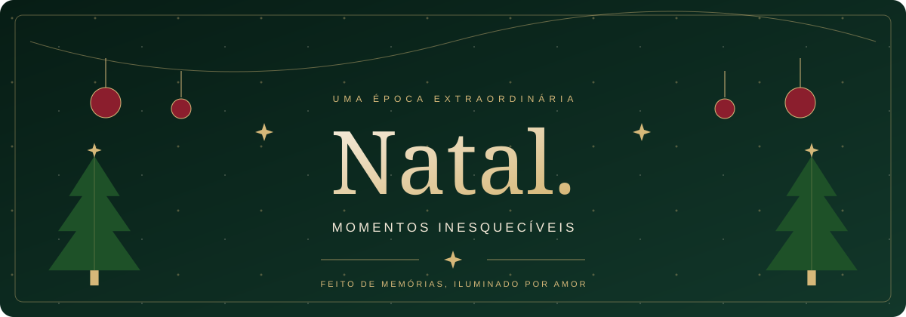
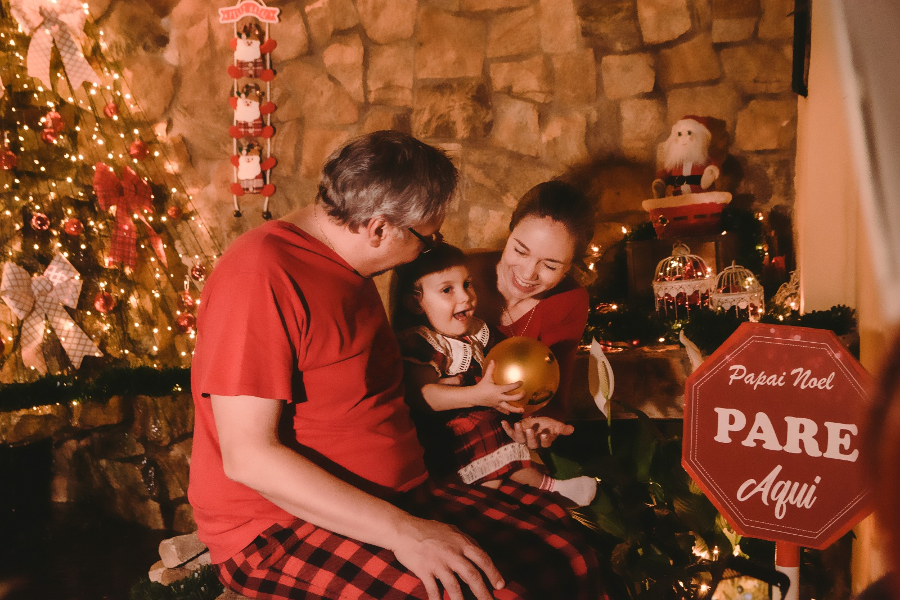
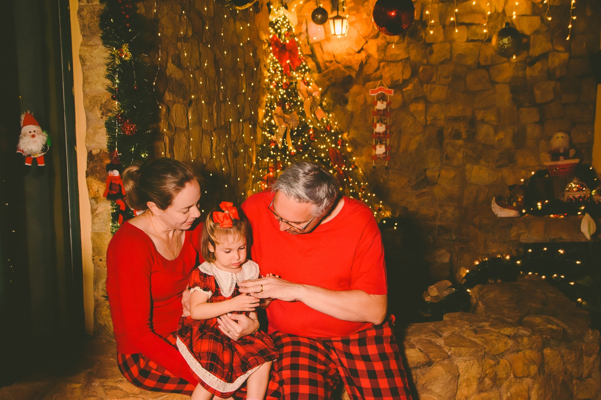
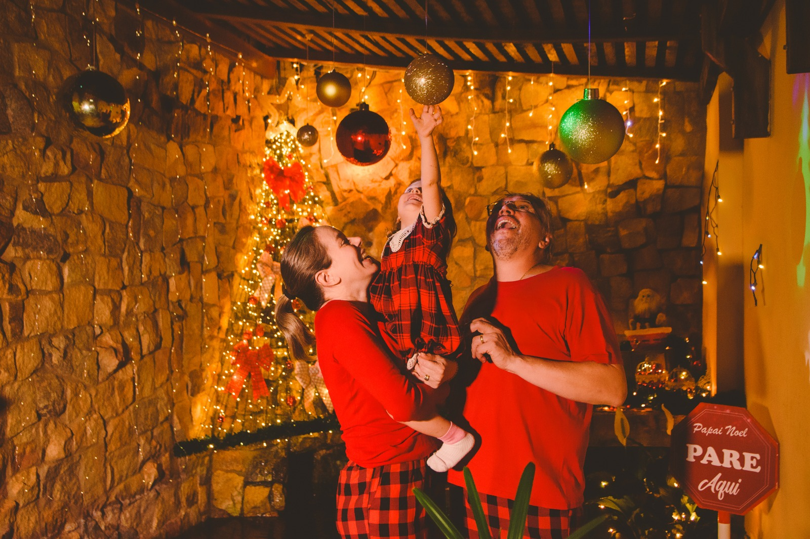

 

**Uma experiência visual sobre o encanto de estar junto.**

Uma landing page natalina que reúne cenários, fotografias e pequenos detalhes 
para transformar a magia do Natal em uma experiência na web.

 

 

[O projeto](#-o-projeto) · [A experiência](#-a-experiência) · [Identidade visual](#-identidade-visual) · [Por dentro do código](#-por-dentro-do-código)

## 🎄 O projeto

**Natal** é um projeto de front-end construído com **React e Vite**, com foco em apresentação visual, navegação por seções e interação com fotografias.

A página combina imagens natalinas, tipografia elegante, luzes douradas e movimento para apresentar três universos de ensaio: **Natal Clássico**, **Noite de Natal** e **Memórias de Natal**. O percurso termina em um convite para conversar pelo WhatsApp.

> “O Natal não vive apenas nos presentes, mas nos momentos que guardamos para sempre.”

 
Imagem utilizada no hero do site.

## ✨ A experiência

| Parte do site | O que acontece |
| :--- | :--- |
| **Início** | Hero com imagem de fundo, sobreposições de luz, título animado e 18 partículas douradas. |
| **Sobre** | Uma apresentação sobre encontros, afeto e memórias, com entrada visual ao chegar à seção. |
| **Ensaios** | Três cards com fotografias, categorias e links para a área de contato. |
| **Galeria** | Seis imagens em mosaico, com ampliação em lightbox. |
| **Contato** | Acesso ao WhatsApp com uma mensagem inicial preenchida e link para voltar ao topo. |

### 🎁 Três universos, infinitas memórias

| Natal Clássico | Noite de Natal | Memórias de Natal |
| :---: | :---: | :---: |
|  |  |  |
| **Tradição** | **Cinematográfico** | **Afeto** |
| Elegância, tradição e luzes douradas. | Uma atmosfera mágica e inesquecível. | Pequenos momentos para guardar. |

### ❄️ Detalhes que fazem parte da navegação

- **Cabeçalho que acompanha a rolagem:** altera o visual após os primeiros 60 pixels.
- **Menu mobile:** abertura e fechamento controlados por estado, com bloqueio da rolagem enquanto está aberto.
- **Galeria interativa:** a fotografia pode ser fechada pelo botão, pelo fundo da sobreposição ou pela tecla **Esc**.
- **Entradas ao rolar:** as seções Sobre, Ensaios e Contato usam `IntersectionObserver`.
- **Imagens sob demanda:** fotografias de Sobre, Ensaios e Galeria usam `loading="lazy"`.
- **Movimento em CSS:** animações de entrada, iluminação, partículas e efeitos de hover.

## 🎨 Identidade visual

A direção visual do site combina **verde profundo**, **vinho**, **dourado** e **creme**, com fotografias em destaque e contrastes que lembram a iluminação de uma noite de Natal.

| Cor | Código | Papel na identidade |
| :--- | :--- | :--- |
| 🌲 Verde natalino | `#12372A` | Base da atmosfera visual |
| 🍃 Verde complementar | `#1E5128` | Luzes e detalhes de apoio |
| 🎀 Vinho | `#8B1E2D` | Destaque em elementos de ação |
| ⭐ Dourado | `#D6B879` | Partículas, linhas e acentos |
| 🕯️ Creme | `#F4E9D8` | Textos e contraste suave |

**Cormorant Garamond** dá personalidade aos títulos, enquanto **Manrope** aparece nos textos e elementos de interface. Os estilos incluem adaptações para diferentes larguras de tela; o hero também possui regras para a preferência de movimento reduzido.

## 🧩 Por dentro do código

| Tecnologia ou recurso | Aplicação |
| :--- | :--- |
| **React 19 + React DOM** | Componentes e renderização da interface |
| **JavaScript com JSX** | Estrutura visual, eventos e listas de conteúdo |
| **Vite 8** | Ferramentas de desenvolvimento e build |
| **CSS** | Layouts, responsividade, gradientes, transições e animações |
| **Hooks do React** | `useState`, `useEffect` e `useRef` para menu, galeria e observação das seções |
| **APIs do navegador** | `IntersectionObserver` e eventos de scroll, resize e teclado |
| **ESLint** | Configuração de análise estática do código |

### 🌟 Organização da interface

O [App.jsx](src/App.jsx) reúne o cabeçalho e as cinco seções da página.

| Caminho | Responsabilidade |
| :--- | :--- |
| [src/React-components/components/Header.jsx](src/React-components/components/Header.jsx) | Cabeçalho, navegação e menu mobile |
| [src/page/Hero.jsx](src/page/Hero.jsx) | Apresentação inicial e partículas |
| [src/page/Sobre.jsx](src/page/Sobre.jsx) | Conteúdo sobre o espírito do Natal |
| [src/page/Ensaios.jsx](src/page/Ensaios.jsx) | Cards dos três temas de ensaio |
| [src/page/Galeria.jsx](src/page/Galeria.jsx) | Mosaico de fotografias e lightbox |
| [src/page/Contato.jsx](src/page/Contato.jsx) | Chamada para contato pelo WhatsApp |
| [src/assets/css](src/assets/css) | Estilos separados por seção |
| [src/assets/images](src/assets/images) | Fotografias, fundos e logo |

<strong>✉️ Um detalhe extra no repositório</strong>

 

O componente [Carta.jsx](src/React-components/components/Carta.jsx) explora a abertura de um envelope por meio de estado e classes CSS. Ele está separado da composição atual do `App.jsx`.

### Feito de memórias, iluminado por amor.

Desenvolvido por [Giovani Manzatto](https://github.com/gmanzattodev)

**🎄 Que a magia do Natal encontre você. ⭐**

